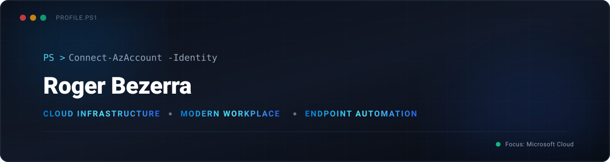

  

# Olá, mundo! Eu sou o Roger Bezerra 👋 / Hi there! I'm Roger Bezerra

---

### 🇧🇷 Sobre Mim
Profissional focado em **Cloud Infrastructure e Modern Workplace / Endpoint Management**. Atuo na governança, padronização e automação de dispositivos e identidades corporativas, provisionamento de políticas de conformidade e segurança, empacotamento e distribuição de aplicações.

- 🔭 **Atuação atual:** Modern Workplace, gerenciamento de dispositivos corporativos e automação via PowerShell.
- 🌱 **Estudando no momento:** Arquitetura Microsoft Cloud (Azure, Entra ID, Intune) e certificações do ecossistema Microsoft.
- 🛠️ **Foco técnico:** Configuração de perfis de conformidade, políticas de acesso condicional, Autopilot e scripts para gestão de endpoints.
- 💬 **Pergunte-me sobre:** Microsoft Intune, Microsoft Entra ID, automação em PowerShell e gestão de ciclo de vida de dispositivos.

---

### 🇺🇸 About Me
IT Professional specialized in **Cloud Infrastructure and Modern Workplace / Endpoint Management**. Focused on enterprise device governance, identity standardization, security baseline and compliance enforcement, application packaging, and zero-touch provisioning.

- 🔭 **Currently working on:** Modern Workplace engineering, enterprise endpoint management, and workflow automation using PowerShell.
- 🌱 **Currently learning:** Deep dive into Microsoft Cloud architecture (Azure, Entra ID, Intune) and enterprise cloud security.
- 🛠️ **Technical focus:** Compliance policies, Conditional Access, Windows Autopilot, and endpoint automation scripts.
- 💬 **Ask me about:** Microsoft Intune, Microsoft Entra ID, PowerShell automation, and endpoint lifecycle management.

---

### 💻 Tecnologias & Ferramentas / Tech Stack

  <!-- Ícones visuais de tecnologias principais -->
  

 

  <!-- Badges com logos oficiais do ecossistema Cloud & Endpoint -->
  
  
  
  
   
  
  
  
  

---

### 📜 Certificações & Estudos / Certifications & In Progress

#### Em Andamento / In Progress

---

### 📊 Métricas & Produtividade / Metrics

  

